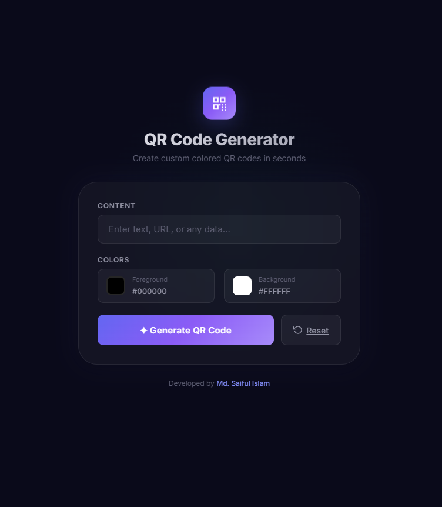
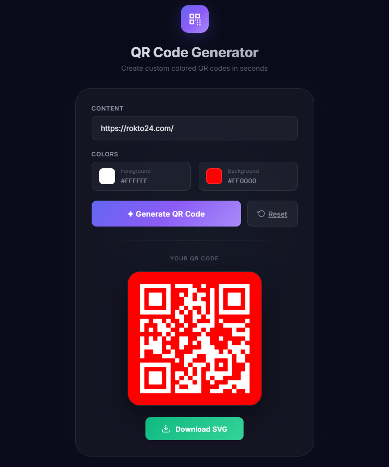

<p align="center">
  
</p>

<h1 align="center">🔲 QR Code Generator</h1>

<p align="center">
  A modern, stylish QR Code Generator built with Laravel — featuring custom color support, instant preview, and SVG download.
</p>

<p align="center">
  
  
  
</p>

---

## ✨ Features

- 🎨 **Custom Colors** — Pick any foreground and background color for your QR code
- 📱 **Fully Responsive** — Beautiful dark-themed UI that works on all devices
- ⬇️ **SVG Download** — Download your QR code as a high-quality SVG file
- 🔄 **Reset Button** — Quickly clear the form and start fresh
- ⚡ **Instant Preview** — See your QR code immediately after generation
- 🌙 **Premium Dark UI** — Glassmorphism design with smooth animations

---

## 📸 Screenshots

|      Generator Form       |      Generated QR Code      |
| :-----------------------: | :-------------------------: |
|  |  |

---

## 🚀 Getting Started

Follow these steps to clone and run the project on your local machine.

### Prerequisites

Make sure you have the following installed:

- **PHP** >= 8.2
- **Composer** (PHP dependency manager)
- **A local server** (e.g., Laragon, XAMPP, WAMP, or Laravel Valet)

### Installation

**1. Clone the repository**

```bash
git clone https://github.com/saifulislam07/qr-generator-laravel.git
```

**2. Navigate to the project folder**

```bash
cd qr-generator-laravel
```

**3. Install PHP dependencies**

```bash
composer install
```

**4. Create the environment file**

```bash
cp .env.example .env
```

**5. Generate the application key**

```bash
php artisan key:generate
```

**6. Run the development server**

```bash
php artisan serve
```

**7. Open in your browser**

```
http://localhost:8000
```

---

## 🛠️ Tech Stack

| Technology                  | Purpose                         |
| --------------------------- | ------------------------------- |
| **Laravel 12**              | Backend framework               |
| **SimpleSoftwareIO/QrCode** | QR code generation              |
| **HTML/CSS/JS**             | Frontend with custom dark theme |
| **Bootstrap 5**             | Responsive grid (CDN)           |

---

## 📁 Project Structure

```
qr-generator-laravel/
├── app/
│   └── Http/Controllers/
│       └── QRController.php        # QR generation & download logic
├── public/
│   ├── img/                        # Screenshot images
│   └── qrcodes/                    # Generated QR code files
├── resources/
│   └── views/qr/
│       └── index.blade.php         # Main UI (dark themed)
├── routes/
│   └── web.php                     # Application routes
└── ...
```

---

## 📝 Usage

1. Open the app in your browser
2. Enter any **text or URL** in the input field
3. Choose a **foreground color** (QR code color)
4. Choose a **background color**
5. Click **"✦ Generate QR Code"**
6. Click **"Download SVG"** to save the file
7. Use the **"Reset"** button to start over

---

## 👤 Author

**Md. Saiful Islam**

- GitHub: [@saifulislam07](https://github.com/saifulislam07)

---

## 📄 License

This project is open-sourced under the [MIT License](https://opensource.org/licenses/MIT).
